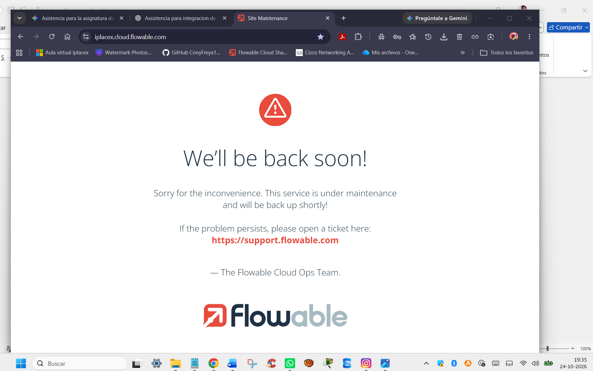
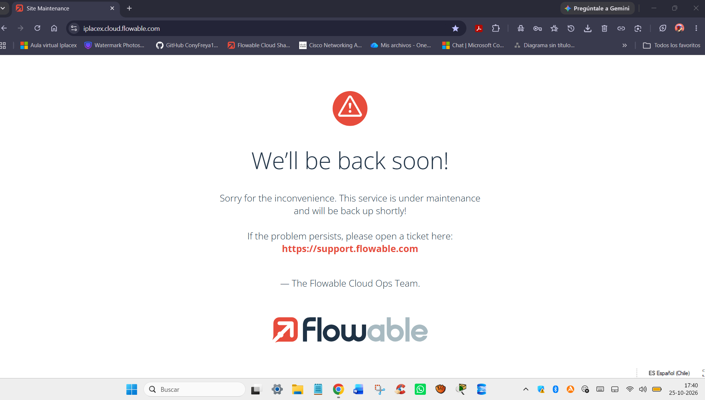
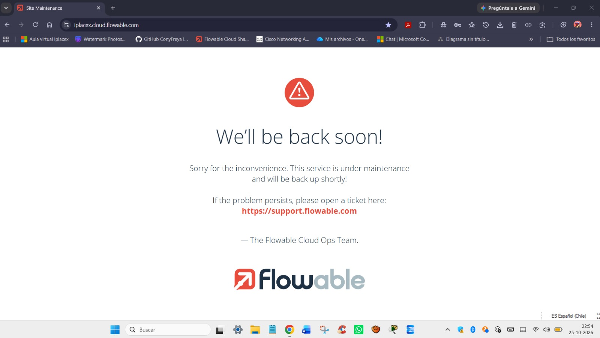

# Acta 3 — Revisión final y cierre de la Primera Entrega

- **Proyecto:** Integración de Plataformas — Peluditos Pet Chile
- **Grupo:** 4
- **Fecha:** 25-10-2026
- **Hora:** 21:47 - 22:00 hrs.
- **Participantes:** Constanza Núñez, Gabriel Arellano, José Loyola y Camila Vega.
- **Modalidad:** Llamada grupal por WhatsApp y coordinación asincrónica.

---

## 1. Objetivo de la Reunión
Verificar los avances subidos por cada integrante al repositorio grupal en GitHub, coordinar los últimos ajustes de documentación para consolidar la Primera Entrega y acordar la organización de tiempos frente a la carga académica paralela antes de iniciar la siguiente etapa.

---

## 2. Revisión de Avances y Estado del Repositorio
Se realizó una revisión cruzada de los directorios del monorepo, confirmando que todos los integrantes completaron sus entregables base de manera modular:

| Área / Directorio | Responsable | Estado Revisado | Detalle de Cierre |
| :--- | :--- | :--- | :--- |
| **`Proyecto-1-WebServices/`** | Camila Vega (`Camila678`) | Completado | Servicio Java REST (`peluditos-webservice`) funcional en puerto `8080`, con `README.md` y captura de evidencia en `/Evidencia`. |
| **`BPMN/`** | José Loyola (`jloyola97`) | Completado | Diagramas `AS-IS` y `TO-BE` (`.bpmn` y `.svg`), evidencia de contingencia de Flowable y actualización de precisión en su `README.md`. |
| **`Base-de-Datos/`** | Gabriel Arellano (`avockato`) | Completado | Script `esquema_peluditos.sql` (tablas `leads` y `seguimientos`, datos y `JOIN`), incorporando su `README.md` descriptivo y evidencias de prueba local. |
| **`Arquitectura/` y `Actas/`** | Constanza Núñez (`ConyFreya180993`) | Completado | Diagrama de arquitectura (primera versión `.png` y `.pptx`), `README.md` de arquitectura, actualización del `README.md` principal y registro de actas. |

---

## 3. Contingencia Técnica Persistente (Flowable Cloud)
- Se verificó durante todo el fin de semana y hasta el cierre de la jornada dominical que la plataforma institucional **Flowable Cloud** (`iplacex.cloud.flowable.com`) permaneció fuera de servicio por mantenimiento del proveedor (*"We'll be back soon! This service is under maintenance"*).
- Debido a esta situación externa de fuerza mayor, la entrega se consolida mediante el enfoque modular desacoplado acordado previamente, dejando documentados los modelos en estándar BPMN 2.0 (`bpmn.io`) y las pruebas locales de backend y base de datos, posponiendo la importación y conexión en vivo hasta que el servicio se restablezca.

### Registro 1: Sábado 24-10-2026 (19:35 hrs.)

### Registro 2: Domingo 25-10-2026 (17:40 hrs.)

### Registro 3: Domingo 25-10-2026 al cierre de entrega (22:54 hrs.)

---

## 4. Acuerdos de Cierre y Planificación Asincrónica
- **Envío individual en plataforma:** Se recuerda y acuerda que cada integrante debe subir de forma individual el enlace del repositorio de GitHub en el Aula Virtual para registrar formalmente su entrega.
- **Pausa de descompresión y carga académica paralela:** Considerando el desgaste de esta etapa y la necesidad de cumplir en paralelo con las evaluaciones y foros de la otra asignatura del bimestre, se acuerda otorgar **un día de margen** tras el envío de esta Primera Entrega antes de retomar las tareas de integración.
- **Coordinación horizontal:** Se mantiene la modalidad de trabajo asincrónica, respetando los turnos laborales y responsabilidades personales de cada miembro del equipo.

---

## 5. Próxima Reunión y Siguientes Pasos
- **Próxima reunión:** Fecha y hora por definir de manera asincrónica vía WhatsApp una vez cumplido el día de margen post-entrega.
- **Próximos pasos estimados para la siguiente fase:**
  - Monitorear el restablecimiento de Flowable Cloud para importar los procesos `.bpmn` y configurar formularios.
  - Coordinar la grabación de los videos de presentación una vez estabilizado el entorno.
  - Homologar los campos definitivos entre los formularios, el servicio Java REST y la base de datos MariaDB para iniciar las pruebas de integración con el *External Worker*.
