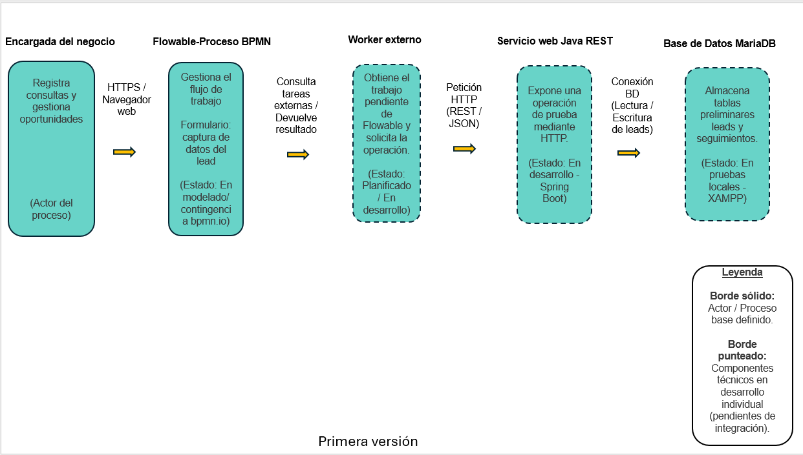

# Arquitectura Preliminar de la Solución — Peluditos Pet Chile

Este directorio contiene el modelo conceptual de arquitectura correspondiente a la **Entrega 1**, junto con su archivo fuente editable (`arquitectura-peluditos.pptx`).

## Esquema de Arquitectura (Primera Versión)

## Componentes del Esquema

1. **Encargada del negocio (Usuario):** Inicia y revisa las gestiones comerciales (registro de consultas y seguimiento de oportunidades).
2. **Flowable (Proceso BPMN + Formularios):** Gestiona el flujo de trabajo propuesto (TO-BE) y la captura de datos de leads mediante formularios. *(Estado actual: En modelado / Contingencia en bpmn.io por caída temporal de plataforma).*
3. **Worker externo:** Componente encargado de obtener el trabajo pendiente de Flowable y solicitar la operación externa. *(Estado actual: Planificado / En desarrollo).*
4. **Servicio web Java REST:** Expone una operación de prueba mediante HTTP para validar la integración técnica. *(Estado actual: En desarrollo con Spring Boot).*
5. **Base de Datos MariaDB:** Almacena las tablas preliminares `leads` y `seguimientos`. *(Estado actual: En pruebas locales con XAMPP).*

## Historial de Diseño en el Archivo Editable (.pptx)

- **Diapositiva 1 (Portada):** Identificación del proyecto Peluditos Pet Chile.
- **Diapositiva 2 (Pre base):** Lluvia de ideas conceptual generada inicialmente para explorar posibles alcances y descartar componentes fuera de la fase actual.
- **Diapositiva 3 (Primera versión):** Modelo de arquitectura depurado y acordado por el equipo para la Entrega 1, acotado a los 5 componentes del flujo principal.
