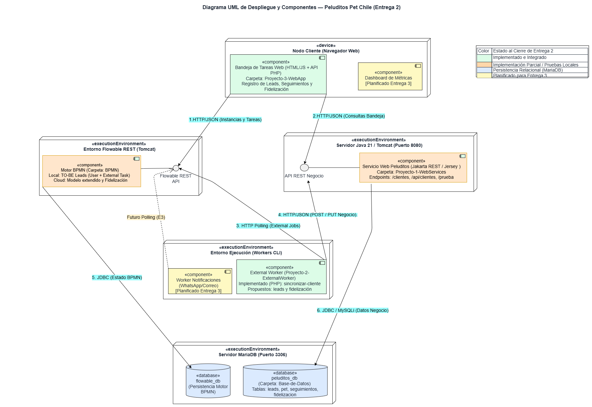

README arquitectura entrega 
# Arquitectura y seguimiento de la Entrega 2

> **Estado del documento:** Versión de cierre Entrega 2 (09/11/2026). El diagrama y la matriz reflejan el estado real de implementación y pruebas alcanzado por el equipo a partir de las evidencias del monorepo.

## 1. Arquitectura de referencia y estado de integración

El sistema se organiza en cuatro capas principales, combinando la arquitectura objetivo con las adaptaciones técnicas implementadas en esta entrega:

1. **Bandeja de Tareas Web (`Proyecto-3-WebApp` — Implementado e Integrado):** Interfaz web en HTML, CSS, JavaScript y servicios PHP (`api/registrar_lead.php`, `listar_seguimientos.php`, `actualizar_seguimiento.php`, `gestionar_fidelizacion.php`, `listar_procesos.php`) ejecutada en Apache/XAMPP. Registra clientes potenciales, inicia instancias del proceso BPMN (`Process_1pot1gs`) vía API REST de Flowable (`Flujo 1`) enviando la variable `id_lead` y gestiona seguimientos y campañas sobre MariaDB.
2. **Motor BPMN Flowable (`BPMN` — Implementación Parcial / Pruebas Locales):** Se desplegó y ejecutó localmente sobre Apache Tomcat el proceso ejecutable `TO-BE.bpmn` (`Process_1pot1gs`), integrando *User Tasks*, compuertas de decisión y una *Service Task* de tipo `external-worker` (`flowable:topic="sincronizar-cliente"`), manteniendo su persistencia interna en `flowable_db` (`Flujo 5`). Los modelos extendidos (incluyendo el flujo completo de *Fidelización* y registro de pérdidas) fueron validados en *Flowable Cloud* debido a inconvenientes técnicos documentados al instalar Flowable OSS 7.2 local.
3. **External Worker (`Proyecto-2-ExternalWorker`) y Servicio Jakarta REST (`Proyecto-1-WebServices`):**
   - **External Worker (Implementado e Integrado en PHP CLI):** El componente `worker.php` (`peluditos-worker-1`) realiza *HTTP Polling* (`Flujo 3`) contra `/external-job-api/acquire/jobs` en el tópico `sincronizar-cliente`, recupera la variable `id_lead`, verifica la información comercial en MariaDB y completa la tarea externa en Flowable.
   - **Servicio Web Jakarta REST (Probado Localmente en Java 21):** Implementado sobre Java 21 con soporte para **Jakarta RESTful Web Services (Jersey)** (`ClientesResource.java` en `/clientes`) y acceso a datos JDBC sobre MariaDB (`/api/clientes` consultando la tabla `leads` y `/api/consultas/prueba` en el puerto 8080). En esta entrega operó en pruebas locales aisladas, mientras la WebApp y el Worker resolvieron la persistencia directa vía PHP (`mysqli`) para asegurar el flujo funcional completo.
4. **Persistencia Relacional en MariaDB (`Base-de-Datos` — Implementado e Integrado):** Esquema `peluditos_db` (`esquema_peluditos.sql`) separado de `flowable_db`, compuesto por cuatro tablas relacionales con integridad referencial (`InnoDB`, `utf8mb4`): `leads`, `pet`, `seguimientos` y `fidelizacion`.

## 2. Estado de los componentes al cierre de la Entrega 2

| Componente | Responsable | Estado E2 | Evidencia y alcance logrado |
| :--- | :--- | :--- | :--- |
| **Arquitectura y documentación** | Constanza Núñez | **Completado** | Diagrama UML de despliegue y componentes (`.png`, `.svg`, `.drawio`), trazabilidad del monorepo y actas de coordinación actualizadas. |
| **Base de datos MariaDB (`Base-de-Datos`)** | Gabriel Arellano | **Implementado e Integrado** | Script `esquema_peluditos.sql` con tablas `leads`, `pet`, `seguimientos` y `fidelizacion`, separación de `flowable_db` y datos de prueba verificados. |
| **Bandeja Web (`Proyecto-3-WebApp`)** | Gabriel Arellano | **Implementado e Integrado** | Interfaz web y API PHP conectadas con MariaDB y Flowable REST (inicio de instancias BPMN, actualización de seguimientos y campañas). Evidencias `04` a `08` cargadas. |
| **External Worker (`Proyecto-2-ExternalWorker`)** | Gabriel Arellano | **Implementado e Integrado** | `worker.php` funcional ejecutando *polling* sobre el tópico `sincronizar-cliente`, validando `id_lead` en `peluditos_db` y completando trabajos en Flowable. |
| **Servicios Jakarta REST (`Proyecto-1-WebServices`)** | Camila Vega | **Probado localmente** | Servicio en Java 21 con `spring-boot-starter-jersey` (Jakarta REST en `/clientes`), controlador JDBC conectado a tabla `leads` (`/api/clientes`) y endpoint `/api/consultas/prueba` verificados en puerto 8080. Pendiente enlazar consumo desde el Worker para la Entrega 3. |
| **Modelos BPMN (`BPMN`)** | José Loyola / Gabriel Arellano | **Implementación Parcial** | Ejecución local lograda con `TO-BE.bpmn` (`Process_1pot1gs`). Los diagramas actualizados de Leads y Fidelización de José Loyola se modelaron en Flowable Cloud por errores de instalación local en OSS 7.2 y mantenimiento de plataforma (respaldado con capturas en `/BPMN/Evidencia`). |

## 3. Criterio aplicado en colores y trazabilidad

- **Verde (Implementado e Integrado):** Componentes con flujo funcional comprobado entre interfaz web, motor BPMN (vía REST), External Worker y base de datos (`peluditos_db`).
- **Naranjo (Implementación Parcial / Pruebas Locales):** Componentes probados de forma aislada (`Proyecto-1-WebServices` en puerto 8080) o con alcance parcial en el entorno local (`BPMN`).
- **Azul (Persistencia Relacional):** Esquemas separados `peluditos_db` y `flowable_db` en MariaDB.
- **Amarillo (Planificado para Entrega 3):** Escalabilidad proyectada (Worker de notificaciones, unificación completa con endpoints Jakarta REST y Dashboard de métricas).
