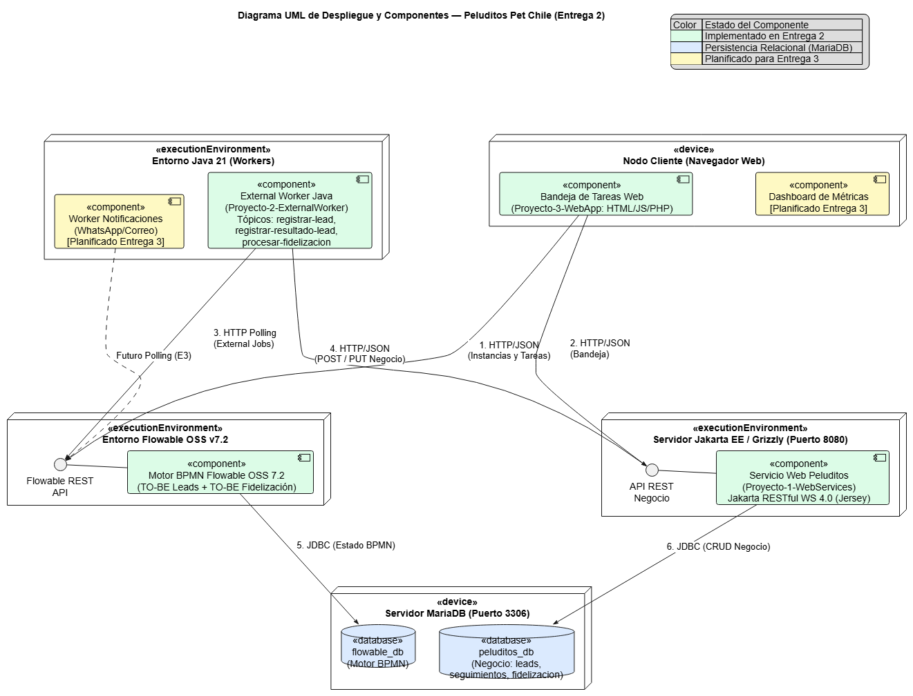

# Arquitectura y seguimiento de la Entrega 2

> **Estado del documento:** Borrador de trabajo. La arquitectura y los estados de implementación se validarán con las evidencias que comparta el equipo. **“Propuesto” no significa “implementado”.**

---

## 1. Arquitectura propuesta

El sistema se organiza en cuatro partes principales:
1. **Bandeja web:** interfaz propia para iniciar procesos y revisar tareas.
2. **Flowable OSS 7.2:** ejecuta los procesos BPMN y mantiene su estado en `flowable_db`.
3. **External Worker y servicio REST:** el worker obtiene trabajos desde Flowable y se comunica con el servicio REST del negocio.
4. **MariaDB:** conserva los datos del negocio en `peluditos_db`, separada de la base de Flowable.

La bandeja web se conectará directamente con el servicio REST del negocio solo si esa consulta forma parte del diseño y está implementada. Las conexiones y componentes del diagrama representan la arquitectura propuesta hasta que se verifiquen mediante pruebas.

---

## 2. Estado de los componentes

| Componente | Responsable | Estado E2 | Evidencia o pendiente |
| :--- | :--- | :--- | :--- |
| **Arquitectura y documentación** | Constanza | En desarrollo / Borrador | Diagrama UML de arquitectura y documentación inicial listos; validar colores finales con la implementación del equipo. |
| **Modelos BPMN y Flowable OSS 7.2** | José | Pendiente de confirmar | Compartir diagramas corregidos y evidencia de ejecución de tareas de usuario y tareas externas. |
| **Base de datos MariaDB** | Gabriel | Pendiente de confirmar | Compartir esquema actualizado y evidencia de persistencia en `peluditos_db` (separada de `flowable_db`). |
| **Servicios Jakarta REST y External Worker** | Camila | Pendiente de confirmar | Compartir operaciones disponibles y pruebas (`curl`/Postman); distinguir pruebas locales de integración con Flowable. |
| **Bandeja web** | Equipo | Pendiente de confirmar | Definir si se presentará como prototipo/*wireframe* o como funcionalidad implementada y probada. |

---

## 3. Criterio para actualizar el estado

- **Propuesto:** está en el diseño, sin evidencia de implementación.
- **En desarrollo:** existe avance, pero aún no está probado.
- **Probado localmente:** funciona de forma aislada; falta confirmar su integración.
- **Integrado y probado:** funciona conectado con los componentes correspondientes y existe evidencia.
- **Pendiente:** no se ha implementado o no se ha confirmado su estado.

Los colores del diagrama se actualizarán según estos estados y las evidencias disponibles. **No se marcará un componente como “integrado y probado” solo porque exista su código o un prototipo.**

---

## 4. Próximo paso

Cada responsable puede actualizar el estado de su componente y enlazar la evidencia correspondiente en su carpeta `/Evidencia`. El objetivo es documentar con claridad lo alcanzado y lo que queda pendiente, sin asumir avances no confirmados.
