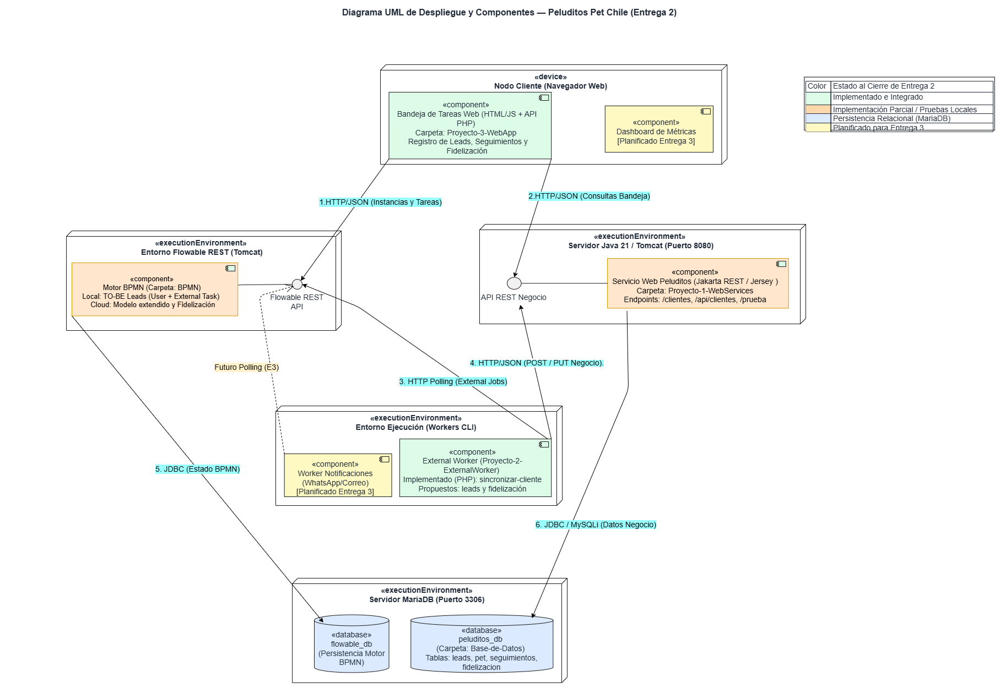

# Peluditos Pet Chile — Sistema de Gestión de Leads y Fidelización (Grupo 4)-Entrega 2

> **Estado del repositorio:** Versión de cierre Entrega 2 (09/11/2026). Este monorepo consolida la arquitectura UML de despliegue y componentes, el modelamiento de procesos BPMN 2.0, la base de datos relacional en MariaDB (`peluditos_db`), los servicios web en Java 21 con Jakarta REST (Jersey) y Spring JDBC, el External Worker en PHP y la Bandeja de Tareas Web.

---

## 1. Índice del Monolito y Matriz de Estados (Cierre Entrega 2)

Siguiendo nuestro criterio de trazabilidad técnica (**"propuesto no significa implementado"**), la siguiente tabla resume el alcance real comprobado por cada módulo y la ubicación de sus evidencias:

| Carpeta / Módulo | Responsable | Estado al Cierre E2 | Artefactos Implementados y Evidencias |
| :--- | :--- | :--- | :--- |
| [`/Arquitectura`](./Arquitectura) | Constanza Núñez | **Completado** | Diagrama UML (`Arquitectura-entrega-2-final.png`, `.svg`, `.drawio`), PPT de evolución desde E1 y [`README.md`](./Arquitectura/README.md). |
| [`/Base-de-Datos`](./Base-de-Datos) | Gabriel Arellano | **Implementado e Integrado** | Script [`esquema_peluditos.sql`](./Base-de-Datos/esquema_peluditos.sql) (`peluditos_db` separada de `flowable_db` con tablas `leads`, `pet`, `seguimientos`, `fidelizacion`) y [`/Evidencia`](./Base-de-Datos/Evidencia). |
| [`/Proyecto-3-WebApp`](./Proyecto-3-WebApp) | Gabriel Arellano | **Implementado e Integrado** | Bandeja de Tareas Web (HTML/CSS/JS) y [`api/`](./Proyecto-3-WebApp/api) en PHP conectada a MariaDB y Flowable REST (`Process_1pot1gs`). Capturas `04` a `08` en [`/evidencia`](./Proyecto-3-WebApp/evidencia). |
| [`/Proyecto-2-ExternalWorker`](./Proyecto-2-ExternalWorker) | Gabriel Arellano | **Implementado e Integrado** | [`worker.php`](./Proyecto-2-ExternalWorker/worker.php) (`peluditos-worker-1`) haciendo *HTTP Polling* sobre el tópico `sincronizar-cliente` y validando `id_lead` en MariaDB. Ver [`/evidencia`](./Proyecto-2-ExternalWorker/evidencia). |
| [`/Proyecto-1-WebServices`](./Proyecto-1-WebServices) | Camila Vega | **Implementado y Probado Localmente** | Proyecto Java 21 con Jakarta REST / Jersey (`/jakarta/clientes`), consulta JDBC a tabla `leads` en MariaDB (`/api/clientes`) y endpoint `/api/consultas/prueba`. Capturas `Prueba_Jakarta_REST.png` y `Prueba_API_REST_MariaDB.png` en [`/Evidencia`](./Proyecto-1-WebServices/Evidencia). |
| [`/BPMN`](./BPMN) | José Loyola / Gabriel Arellano | **Implementación Parcial** | [`TO-BE.bpmn`](./BPMN/TO-BE.bpmn) ejecutado localmente en Tomcat/Flowable REST y [`modelo to-be+fidelizacion.bpmn`](./BPMN/modelo%20to-be+fidelizacion.bpmn) validado sin errores. Respaldo de contingencia en [`/BPMN/Evidencia`](./BPMN/Evidencia). |
| [`/Videos/Entrega-2`](./Videos/Entrega-2) | Equipo Grupo 4 | **Completado** | Enlaces a defensas técnicas modulares en [`/Videos/Entrega-2/Tecnico/README.md`](./Videos/Entrega-2/Tecnico/README.md). |
| [`/Actas`](./Actas) | Constanza Núñez | **Completado** | Actas de coordinación asíncrona, asignación de tareas y cierre de control de calidad. |

---

## 2. Arquitectura del Sistema y Capas de Integración

El sistema evoluciona a partir de la retroalimentación de la Entrega 1 hacia un diseño desacoplado en cuatro capas principales:

1. **Capa de Presentación y Bandeja Web (`Proyecto-3-WebApp` — Verde):** Interfaz web ejecutada sobre Apache (XAMPP) cuyos servicios PHP (`registrar_lead.php`, `listar_seguimientos.php`, `actualizar_seguimiento.php`, `gestionar_fidelizacion.php`, `listar_procesos.php`) insertan prospectos en MariaDB e inician instancias del proceso BPMN en la API REST de Flowable (`Flujo 1`) enviando la variable `id_lead`.
2. **Capa de Orquestación BPMN (`BPMN` — Naranjo):**
   - **Ejecución Local:** El proceso `TO-BE.bpmn` (`Process_1pot1gs`) corre sobre Apache Tomcat consumiendo `flowable_db` (`Flujo 5`), gestionando tareas de usuario y publicando trabajos externos en el tópico `sincronizar-cliente`.
   - **Modelado Extendido (Leads + Fidelización):** Los archivos `modelo to-be+fidelizacion.bpmn` y `TO-BE fidelizacion.bpmn` incorporan la rama de descarte (`Registrar Venta no Realizada` / tópico `registrar resultado lead`) y el proceso independiente activado por mensaje (`iniciar campaña` con los tópicos `registrar datos campaña iniciada` y `registrar si cliente muestra interes en la oferta`).
3. **Capa de Workers y Servicios Web REST (`Proyecto-2-ExternalWorker` en Verde / `Proyecto-1-WebServices` en Naranjo):**
   - **External Worker (`worker.php`):** Realiza *HTTP Polling* (`Flujo 3`) sobre `/external-job-api/acquire/jobs` para el tópico `sincronizar-cliente`, recupera `id_lead`, verifica la existencia del cliente en `peluditos_db` y completa la tarea en Flowable.
   - **Servicios Web REST en Java 21 (`Proyecto-1-WebServices`):** Configurados en el puerto `8080` con **Jakarta REST (Jersey)** configurado como filtro en `/jakarta/clientes` (`ClientesResource.java`) y **Spring JDBC (`JdbcTemplate`)** en `/api/clientes` (`ClientesController.java`) consultando `SELECT * FROM leads` sobre `peluditos_db` con credenciales externalizadas (`PELUDITOS_DB_PASSWORD`). Queda planificada para la Entrega 3 la invocación conjunta entre el Worker y los endpoints REST propuestos (`POST /api/consultas`, `GET /api/consultas/{id}`, `PATCH /api/consultas/{id}/resultado`).
4. **Capa de Persistencia Relacional (`Base-de-Datos` — Azul):** Esquema comercial `peluditos_db` en MariaDB (puerto `3306`, motor `InnoDB`, `utf8mb4`), estrictamente separado de la base interna `flowable_db`.

---

## 3. Procesos de Negocio (AS-IS vs. TO-BE)

| Proceso / Problema | Situación Actual (AS-IS) | Situación Implementada / Propuesta (TO-BE) | Beneficio Logrado |
| :--- | :--- | :--- | :--- |
| **1. Captura de Leads** | Consultas dispersas en historiales de WhatsApp, Instagram y Facebook. | Registro centralizado en la Bandeja Web (`Proyecto-3-WebApp`) que persiste en `leads` e inicia instancia en Flowable. | Trazabilidad completa de prospectos y vinculación mediante `id_lead`. |
| **2. Seguimiento Comercial** | Pérdida de oportunidades por falta de seguimiento sistemático. | Gestión de estados (`Pendiente`, `Venta Concretada`, `Venta No Concretada`) y sincronización vía External Worker. | Visibilidad del embudo comercial y cierre controlado de instancias BPMN. |
| **3. Fechas Clave y Fidelización** | Sin registro estructurado de cumpleaños de mascotas ni campañas. | Proceso independiente por evento de mensaje (`iniciar campaña`) y tablas relacionales `pet` y `fidelizacion`. | Gestión de campañas (`Cumpleaños`, `Celebración`) con estados `Programado` y `Enviado`. |

---

## 4. Estructura de la Base de Datos Comercial (`peluditos_db`)

Implementada en [`Base-de-Datos/esquema_peluditos.sql`](./Base-de-Datos/esquema_peluditos.sql):

- **`leads`:** `id_lead` (PK, `AUTO_INCREMENT`), `nombre_cliente`, `contacto_cliente`, `canal_origen` (`WhatsApp`, `Instagram`, `Facebook`), `fecha_registro`.
- **`pet`:** `id_pet` (PK), `id_lead` (FK a `leads`), `nombre_mascota`, `tipo_pet` (`Gato`, `Perro`), `cumpleanos` (`DATE`).
- **`seguimientos`:** `id_seguimiento` (PK), `id_pet` (FK a `pet`), `consulta`, `tamano_pastel` (`Pequeño`, `Mediano`, `Grande`), `resultado_consulta` (`Venta Concretada`, `Venta No Concretada`, `Pendiente`), `fecha_registro_consulta`, `fecha_entrega`.
- **`fidelizacion`:** `id_fidelizacion` (PK), `id_pet` (FK a `pet`), `fecha_evento`, `tipo_campana` (`Cumpleaños`, `Celebración`), `estado_envio` (`Programado`, `Enviado`).

---

## 5. Registro de Dificultades Técnicas y Soluciones Aplicadas

1. **Coexistencia de Jakarta REST (Jersey) y Spring MVC (`Proyecto-1-WebServices`):**
   - *Dificultad:* Error HTTP 404 inicial al exponer simultáneamente controladores REST y recursos de Jersey.
   - *Solución:* Se configuró Jersey como filtro bajo el prefijo `spring.jersey.application-path=/jakarta` en `application.properties`, permitiendo operar `/jakarta/clientes` junto con la consulta JDBC a MariaDB en `/api/clientes` (ver [`Proyecto-1-WebServices/Evidencia`](./Proyecto-1-WebServices/Evidencia)).
2. **Instalación Local de Flowable OSS 7.2 y Caída de Portal Trial (`BPMN`):**
   - *Dificultad:* Se presentaron errores de dependencias al instalar Flowable OSS 7.2 en uno de los equipos locales, sumado a la ventana de mantenimiento del servicio *Flowable Trial* el domingo 08/11/2026 (respaldado en [`BPMN/Evidencia/servicio trial flowable en mantenimiento.png`](./BPMN/Evidencia/servicio%20trial%20flowable%20en%20mantenimiento.png)).
   - *Solución:* Se resguardaron los modelos extendidos en estándar XML BPMN 2.0 (`modelo to-be+fidelizacion.bpmn`) y se ejecutaron las pruebas de integración del External Worker y la WebApp sobre el entorno local Apache Tomcat/XAMPP del equipo utilizando `TO-BE.bpmn`.

---

## 6. Videos de Defensa Técnica (Entrega 2)

Los enlaces a las presentaciones técnicas modulares de cada integrante se encuentran centralizados en:
- 👉 **[`Videos/Entrega-2/Tecnico/README.md`](./Videos/Entrega-2/Tecnico/README.md)**
