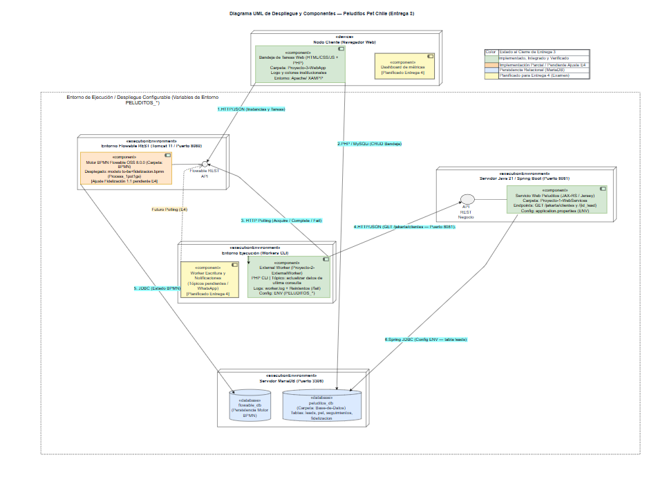

# Peluditos Pet Chile — Sistema de Gestión de Leads y Fidelización (Grupo 4)

> **Estado del repositorio:** Versión de cierre **Entrega 3** (23/11/2026). Este monorepo consolida la integración desacoplada entre la Bandeja de Tareas Web (PHP/HTML/JS con identidad visual institucional), el motor de procesos Flowable OSS 8.0.0, el External Worker en PHP con manejo de reintentos, el servicio web **Jakarta REST (JAX-RS)** en Java 21 y la base de datos relacional MariaDB (`peluditos_db` separada de `flowable_db`).

---

## 1. Índice del Monorepo y Matriz de Estados (Cierre Entrega 3)

| Carpeta / Módulo | Responsable | Estado al Cierre E3 | Artefactos Implementados y Evidencias |
| :--- | :--- | :--- | :--- |
| [`/Arquitectura`](./Arquitectura) | Constanza Núñez | **Completado** | Diagrama UML actualizado (`Arquitectura-entrega-3-final`) con límites de despliegue y [`README.md`](./Arquitectura/README.md). |
| [`/Base-de-Datos`](./Base-de-Datos) | Gabriel Arellano | **Completado e Integrado** | [`esquema_peluditos.sql`](./Base-de-Datos/esquema_peluditos.sql) (`leads`, `pet`, `seguimientos`, `fidelizacion` con 3 FKs), [`README.md`](./Base-de-Datos/README.md) actualizado y 6 capturas en [`/Evidencia`](./Base-de-Datos/Evidencia). |
| [`/Proyecto-1-WebServices`](./Proyecto-1-WebServices) | Camila Vega | **Implementado y Verificado (JAX-RS)** | `ClientesResource.java` (Jersey/JAX-RS + `JdbcTemplate`): `GET /jakarta/clientes` y `GET /jakarta/clientes/{id_lead}` (HTTP `400`/`404`). Configuración por ENV en `application.properties` (puerto `8081`). Capturas `Entrega3_*.png` en [`/Evidencia`](./Proyecto-1-WebServices/peluditos-webservice/Evidencia). |
| [`/Proyecto-2-ExternalWorker`](./Proyecto-2-ExternalWorker) | Gabriel Arellano | **Implementado e Integrado** | [`worker.php`](./Proyecto-2-ExternalWorker/worker.php) desacoplado de MariaDB: consume `GET /jakarta/clientes` (`8081`), atiende el tópico `actualizar datos de ultima consulta`, escribe `worker.log`, reporta fallos (`/fail`) con 3 reintentos y lee variables de entorno. |
| [`/Proyecto-3-WebApp`](./Proyecto-3-WebApp) | Gabriel Arellano | **Implementado e Integrado** | Bandeja Web con identidad visual de Peluditos Pet Chile (`img/logo-peluditos-chile.webp` y paleta naranjo en CSS), API PHP conectada a `peluditos_db` y Flowable REST (`Process_1pot1gs`). |
| [`/BPMN`](./BPMN) | José Loyola / Gabriel Arellano | **Implementación Parcial** | [`modelo to-be+fidelizacion.bpmn`](./BPMN/modelo%20to-be+fidelizacion.bpmn) (`Process_1pot1gs`) desplegado y probado en Flowable OSS 8.0.0. Ajuste de Fidelización (1 instancia por cliente) en versión paralela para Entrega 4. |
| [`/Videos/Entrega-3`](./Videos/Entrega-3) | Equipo Grupo 4 | **En consolidación** | Defensas técnicas en [`/Videos/Entrega-3/Tecnico/README.md`](./Videos/Entrega-3/Tecnico/README.md) y cápsula de negocio en [`/Videos/Entrega-3/Emprendedora/README.md`](./Videos/Entrega-3/Emprendedora/README.md). |
| [`/Actas`](./Actas) | Constanza Núñez | **Completado** | Actas de planificación y cierre (`Acta-01` a `Acta-07`). |

---

## 2. Arquitectura del Sistema (Entrega 3)



### Flujo Integrado Demostrado (Recorrido Principal de Leads)
1. **Registro desde Bandeja Web (`Proyecto-3-WebApp`):** El usuario registra un cliente potencial en la interfaz web (con logotipo y paleta institucional). `api/registrar_lead.php` guarda el registro en `peluditos_db.leads` e inicia una instancia de `Process_1pot1gs` en Flowable REST (`puerto 8080`) pasando `id_lead`.
2. **Orquestación en Flowable OSS 8.0.0 (`BPMN`):** Se completan las tareas de usuario (*responder consulta registrando datos* y *agendar seguimiento comercial*). Si `seConcretoLaVenta == true`, el motor genera un trabajo externo en el tópico `actualizar datos de ultima consulta`.
3. **Automatización vía External Worker (`Proyecto-2-ExternalWorker`):** `worker.php` adquiere el trabajo desde Flowable (`8080`) y, **sin conectarse a MariaDB**, consulta al servicio web **Jakarta REST** (`Proyecto-1-WebServices`, puerto `8081`).
4. **Consulta de Persistencia vía JAX-RS (`Proyecto-1-WebServices`):** `ClientesResource.java` consulta `peluditos_db` (`3306`) mediante `JdbcTemplate` y retorna el JSON del cliente.
5. **Cierre o Reintento:** Si la verificación es exitosa, el Worker completa el trabajo y el proceso finaliza en **Lead convertido en cliente**. Si ocurre un error (servicio caído o `id_lead` inexistente), registra el evento en `worker.log` e informa a Flowable vía `/fail` para reintento automático cada `30s`.

---

## 3. Configuración Externa y Portabilidad entre Entornos

No se almacenan contraseñas reales en los servicios externalizados. Los parámetros variables entre equipos se definen mediante variables de entorno con prefijo `PELUDITOS_`:

### A. Servicio Web Jakarta REST (`application.properties`)

| Variable de Entorno | Descripción | Valor por Defecto / Ejemplo |
| :--- | :--- | :--- |
| `PELUDITOS_SERVER_PORT` | Puerto HTTP del servicio Java (usar `8081` para evitar choque con Flowable) | `8080` *(integración: `8081`)* |
| `PELUDITOS_JERSEY_PATH` | Ruta base para endpoints JAX-RS (Jersey) | `/jakarta` |
| `PELUDITOS_DB_URL` | Cadena JDBC hacia MariaDB | `jdbc:mariadb://127.0.0.1:3306/peluditos_db` |
| `PELUDITOS_DB_USER` | Usuario de conexión a MariaDB | `peluditos_app` |
| `PELUDITOS_DB_PASSWORD` | Contraseña de MariaDB *(sin valor en el repositorio)* | *(Definir en el entorno)* |

### B. External Worker PHP (`worker.php`)

| Variable de Entorno | Descripción | Valor por Defecto (Local) |
| :--- | :--- | :--- |
| `PELUDITOS_FLOWABLE_URL` | URL base de Flowable REST | `http://127.0.0.1:8080/flowable-rest` |
| `PELUDITOS_FLOWABLE_USER` | Usuario de API REST de Flowable | *(Definir en el entorno)* |
| `PELUDITOS_FLOWABLE_PASSWORD` | Contraseña de API REST de Flowable | *(Definir en el entorno)* |
| `PELUDITOS_WS_URL` | URL base del servicio web JAX-RS | `http://127.0.0.1:8081/jakarta` |
| `PELUDITOS_WORKER_ID` | Identificador del Worker | `peluditos-worker-1` |

```powershell
# Ejemplo de variables en PowerShell (sin secretos reales)
$env:PELUDITOS_SERVER_PORT = "8081"
$env:PELUDITOS_DB_URL = "jdbc:mariadb://127.0.0.1:3306/peluditos_db"
$env:PELUDITOS_DB_USER = "peluditos_app"
$env:PELUDITOS_DB_PASSWORD = "<TU_PASSWORD_BD>"
$env:PELUDITOS_WS_URL = "[http://127.0.0.1:8081/jakarta](http://127.0.0.1:8081/jakarta)"

```

---

## 4. Instrucciones de Despliegue (Entorno Limpio)

### Requisitos y Versiones

* **Base de datos y servidor Web PHP:** XAMPP (Apache + MariaDB `InnoDB`/`utf8mb4` + PHP 8.x).
* **Motor BPMN:** Flowable OSS 8.0.0 (`flowable-rest.war`) sobre Apache Tomcat 11 con **Java 17**.
* **Servicios Web REST:** **Java JDK 21** y Apache Maven Wrapper (`mvnw.cmd`).

### Orden de Instalación y Arranque

1. **MariaDB y Apache (XAMPP):** Iniciar `MySQL` (`3306`) y `Apache`. Importar [`Base-de-Datos/esquema_peluditos.sql`](https://www.google.com/search?q=./Base-de-Datos/esquema_peluditos.sql) para crear `peluditos_db` y crear la base vacía `flowable_db`.
2. **Flowable OSS (`puerto 8080`):** Iniciar Tomcat 11 con Java 17 indicando la configuración externa `-Dspring.config.additional-location` apuntando a `flowable_db` (con `sslMode=disable`). Desplegar [`BPMN/modelo to-be+fidelizacion.bpmn`](https://www.google.com/search?q=./BPMN/modelo%2520to-be%2Bfidelizacion.bpmn).
3. **Servicio Web Jakarta REST (`puerto 8081`):**
```powershell
cd Proyecto-1-WebServices\peluditos-webservice
$env:PELUDITOS_SERVER_PORT = "8081"
$env:PELUDITOS_DB_PASSWORD = "<TU_PASSWORD_BD>"
.\mvnw.cmd spring-boot:run

```


4. **External Worker (`Proyecto-2-ExternalWorker`):**
```powershell
cd Proyecto-2-ExternalWorker
C:\xampp\php\php.exe worker.php

```


5. **Bandeja Web (`Proyecto-3-WebApp`):** Copiar la carpeta en `htdocs/peluditos/` de XAMPP y abrir `http://localhost/peluditos/`.

---

## 5. Pruebas Realizadas, Manejo de Errores y Limitaciones Conocidas

| Escenario | Componente(s) | Resultado Verificado | Evidencia |
| --- | --- | --- | --- |
| **1. Recorrido completo exitoso** | Flowable + Worker + JAX-RS + MariaDB | Con `id_lead = 1` y venta concretada, el Worker consulta `GET /jakarta/clientes` y completa el proceso en **Lead convertido en cliente**. | `Proyecto-2-ExternalWorker/README.md` |
| **2. Consulta individual por ID** | `Proyecto-1-WebServices` (JAX-RS) | `GET /jakarta/clientes/1` devuelve el JSON del cliente desde `peluditos_db`. | `Entrega3_Consulta_Cliente_ID.png` |
| **3. Cliente inexistente (HTTP 404)** | JAX-RS y External Worker | `GET /jakarta/clientes/999` devuelve **HTTP 404**; el Worker registra el error en `worker.log` y descuenta reintentos sin avanzar erróneamente el proceso. | `Entrega3_Cliente_No_Encontrado.png` |
| **4. Servicio Web caído y recuperación** | External Worker + Flowable | Con Java detenido (`HTTP 0`), el Worker reporta `/fail` (`30s`) y **recupera y completa la tarea automáticamente** al levantar el servicio. | `Proyecto-2-ExternalWorker/README.md` |
| **5. Validación de entrada** | WebApp y JAX-RS | Teléfono chileno (`+569` + 8 dígitos) obligatorio en formulario; HTTP `400` en JAX-RS para `id_lead <= 0`. | `script.js` y `ClientesResource.java` |

### Limitaciones Conocidas al Cierre de la Entrega 3

1. **Configuración externa pendiente en WebApp PHP:** `conexion.php` y `flowable_config.php` conservan parámetros locales en código.
2. **Consumo de listado vs. endpoint individual en el Worker:** `ClientesResource.java` ya expone `GET /jakarta/clientes/{id_lead}`, pero `worker.php` aún consulta el listado completo y filtra en memoria.
3. **BPMN de Fidelización y tópicos de escritura:** Pendiente integrar el ajuste de 1 instancia por cliente individual en Fidelización e implementar los endpoints de escritura para los 3 tópicos pendientes.

---

## 6. Plan de Cierre hacia la Entrega 4 (Examen Final)

| Prioridad | Tarea Pendiente | Módulo(s) | Responsable |
| --- | --- | --- | --- |
| **Alta** | Externalizar `conexion.php` y `flowable_config.php` mediante variables de entorno / `.env.example`. | `Proyecto-3-WebApp` | Gabriel Arellano |
| **Alta** | Actualizar `buscarCliente()` en `worker.php` para consumir `GET /jakarta/clientes/{id_lead}` y estandarizar nombres de tópicos sin espacios ni tildes. | `Proyecto-2-ExternalWorker` | Gabriel Arellano |
| **Alta** | Integrar modelo BPMN de Fidelización con **1 instancia por cliente/oportunidad individual**. | `BPMN` | José Loyola |
| **Media** | Incorporar endpoints de escritura (`POST`/`PATCH`) en JAX-RS para habilitar los 3 tópicos pendientes. | `Proyecto-1-WebServices` | Camila Vega |
| **Media** | Actualizar guía de despliegue definitiva, diagrama final y preparación de defensa de Examen. | `Arquitectura` / `Actas` | Constanza Núñez |

---

## 7. Videos de Presentación (Entrega 3)

* 👉 **Videos Técnicos para el Docente:** [`Videos/Entrega-3/Tecnico/README.md`](https://www.google.com/search?q=./Videos/Entrega-3/Tecnico/README.md)
* 👉 **Video para la Emprendedora:** [`Videos/Entrega-3/Emprendedora/README.md`](https://www.google.com/search?q=./Videos/Entrega-3/Emprendedora/README.md)


